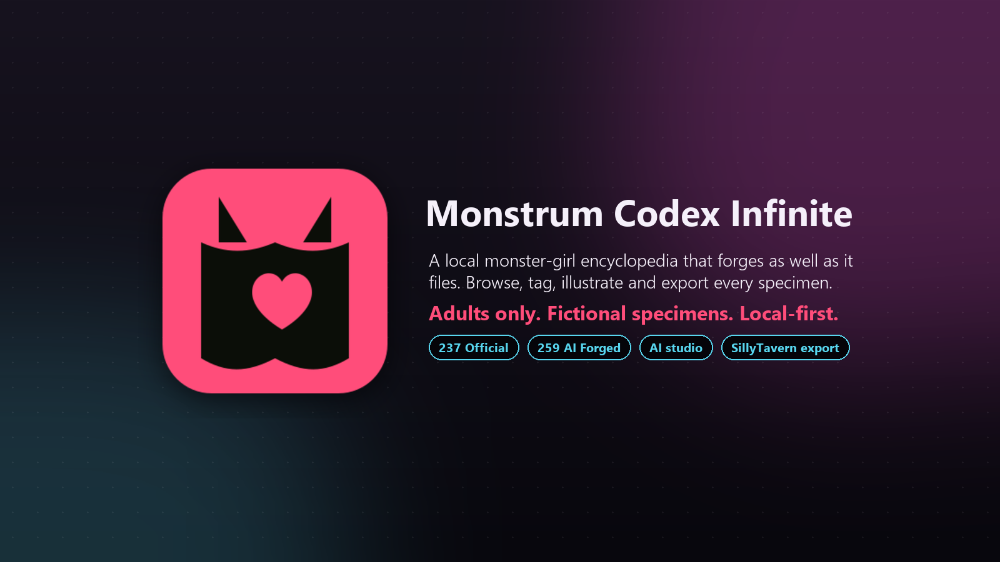
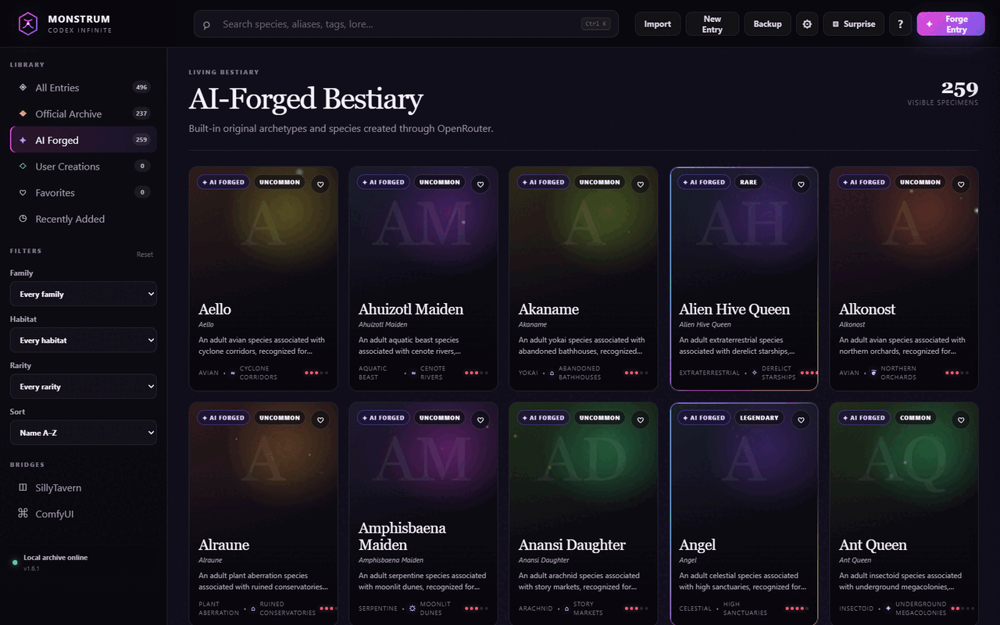
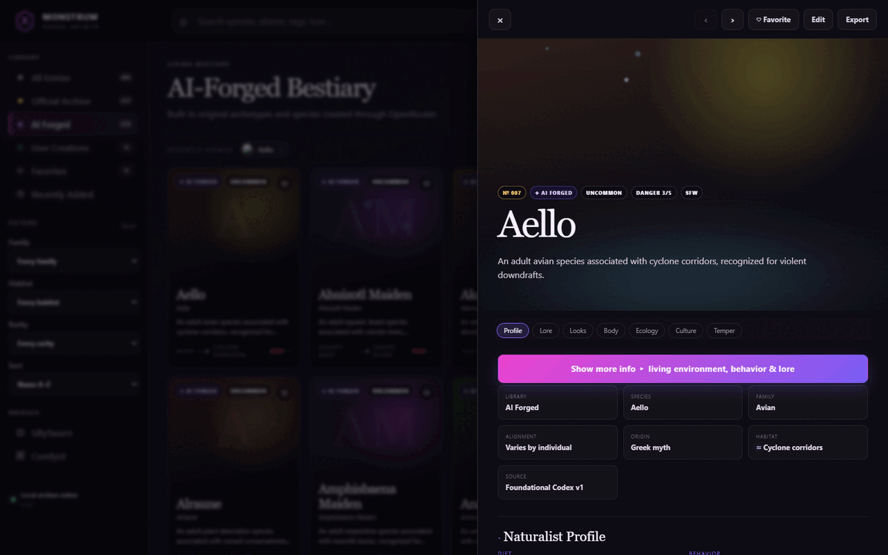
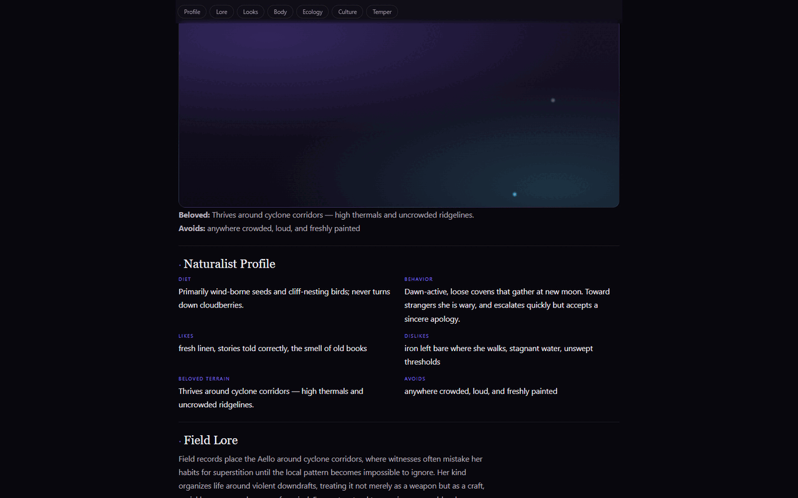
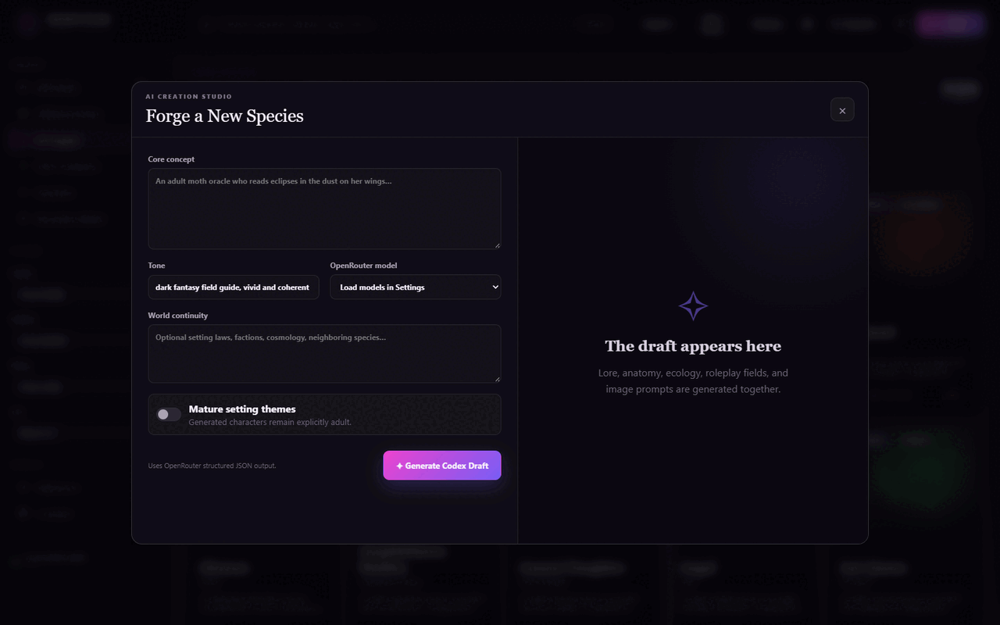
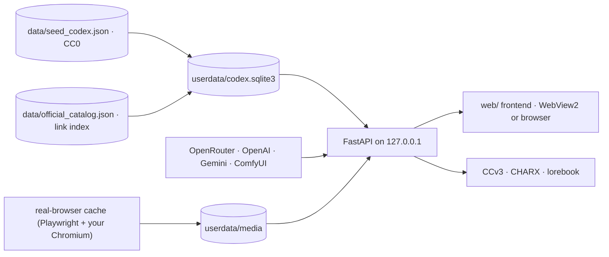
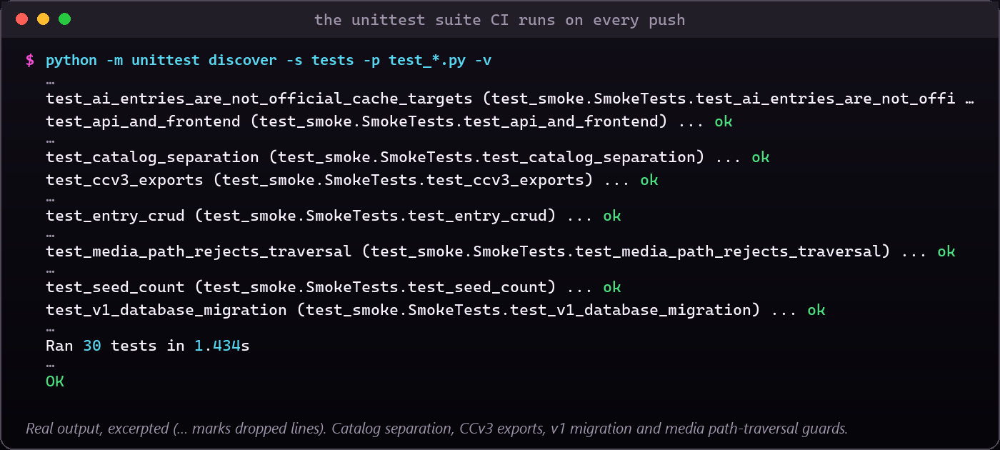

<div align="center">



[](https://github.com/SenjuWoo/monstrum-codex-infinite/actions/workflows/ci.yml)
[](CHANGELOG.md)
[](requirements.txt)
[](DATA-LICENSE.md)
[](LICENSE)

**[Run it](#run)** · **[Tour](#a-two-minute-tour)** · **[Libraries](#libraries)** · **[Official cache](#official-media-cache)** · **[AI portraits](#generate-missing-ai--user-portraits)** · **[How it works](#how-it-works)** · **[Changelog](CHANGELOG.md)**

</div>

Monstrum Codex Infinite is an adult fictional bestiary and AI creation studio:
succubi, lamia, alraune and every other specimen the archive will hold, browsed,
tagged, illustrated and exported from one local app. A monster-girl encyclopedia
is useless as a folder of unmarked JPEGs. You want dense browsing, source-aware
records, anatomy / ecology / culture / abilities / weaknesses / roleplay fields on
one card, and an AI studio that can forge a new succubus without pretending she is
"official."

Inspired by the *workflow* of Bionus Grabber (dense browse, local cache, fast inspect). Not a fork. No Grabber code.

**Adults only. Fictional specimens. No child or age-ambiguous entries.**

This git tree is **source only**. `userdata/` (SQLite, API keys, cached portraits, generated art, browser profile) is gitignored. Original bundled prose in `data/seed_codex.json` is **CC0 1.0**. The Official Archive is a **source-link index**, not a dump of Monster Girl Encyclopedia page text or image binaries.

## What you get

- **Three libraries that cannot impersonate each other:** Official Archive, AI Forged and User Creations. A generated succubus cannot silently wear an Official badge.
- **A naturalist profile on every entry:** diet, cycle, social structure, disposition, danger response, likes / dislikes and terrain.
- **A living codex:** habitat scenes drawn on a local canvas (embers, snow, fireflies, dust; no GIFs, no network), danger-reactive particles, holographic foil on Rare / Mythic / Legendary, card tilt and hero parallax.
- **The other page:** a full-screen dossier with a living-environment stage, next to the side panel that keeps you in the grid.
- **Fast search and filters:** family, habitat, rarity, danger, favorites and recency.
- **An editor for everything:** anatomy, ecology, culture, abilities, weaknesses, image prompts, provenance and roleplay.
- **AI forge and art:** OpenRouter lore forge; OpenAI / Gemini image APIs; ComfyUI; ChatGPT / Gemini subscription handoff.
- **SillyTavern exports:** CCv3 JSON, CCv3 PNG, CHARX and lorebook JSON.
- **A real-browser Official cache** for images and article text (Cloudflare-facing wiki; no HTTP impersonation).
- **A Windows desktop shell** (Edge WebView2) with a browser fallback, and 30 unittest methods in `tests/test_smoke.py`.


<table>
<tr>
<td width="50%"></td>
<td width="50%"></td>
</tr>
<tr>
<td width="50%"></td>
<td width="50%"></td>
</tr>
</table>

<p align="center"><sub>Real headless captures of the app running locally on a fresh <code>userdata/</code>: no wiki media cached, no portraits generated, no API keys set.</sub></p>

## Run

Windows, first launch:

```text
run_windows.bat
```

Creates `.venv`, installs `requirements.txt`, starts the local server, opens the desktop window. Data goes in `userdata/`.

Browser-only: `run_browser_windows.bat`. Linux: `run_linux.sh`.

Developer:

```powershell
python -m venv .venv
.venv\Scripts\activate
pip install -r requirements.txt
python -m uvicorn app.main:app --host 127.0.0.1 --port 17373
```

Then open `http://127.0.0.1:17373`.

Double-launch: `desktop.py` reuses the running instance instead of failing to bind the port.

### Upgrade from v1.0 / v1.1

Copy the old `userdata/` folder into the new tree (or extract over a copy). First launch migrates `catalog_kind` / `image_url`, parks bundled seed entries in **AI Forged**, keeps identifiable hand-made records in **User Creations**, and adds missing Official index rows without overwriting edits. Back up `userdata/` first.

## A two-minute tour

1. The app opens in **Official Archive**. Switch libraries in the sidebar; **All Entries** groups them, never interleaves them.
2. Search with `Ctrl+K`, or narrow by family, habitat, rarity and sort order.
3. Click a card: the side panel opens over the grid. ←/→ browse entries.
4. **Show more info** opens the full-screen dossier with its Living Environment stage. `Esc` returns to the codex view.
5. **Forge Entry** drafts a new species through OpenRouter; **New Entry** opens the editor for your own.
6. From any entry, **Export** to SillyTavern; **Backup** saves the codex.

## Libraries

| Library | In this tree | Images |
| --- | --- | --- |
| **Official Archive** | 237 indexed Monster Girl Encyclopedia profiles (`data/official_catalog.json`) | Cached on your machine from the canonical wiki. Not in git. |
| **AI Forged** | 259 bundled original / public-domain archetypes (`data/seed_codex.json`, CC0) plus anything you generate | No wiki mugshot. Generate portraits or attach files. Aello, Ahuizotl Maiden, and the purple-badged Akaname are **AI Forged**, not Official. |
| **User Creations** | Empty until you write / import | Local art or the same generation batch |

## Official media cache

The source wiki puts pages, the MediaWiki API, and image redirects behind Cloudflare (HTTP 403 to ordinary app requests). Caching uses a **real installed Chromium** via Playwright, not header spoofing.

- Settings → Data → **Open Real-Browser Cache**
- or `cache_official_images_windows.bat`

What it does:

1. Prefers Edge, then Chrome, Brave, Opera. Override with `MONSTRUM_BROWSER`.
2. One Playwright-owned persistent context, session in `userdata/official-browser-profile-v2/`.
3. You complete any visible Cloudflare check. Keep that window open while it runs.
4. Indexes **Mugshot Image** and **Profile Image** categories.
5. Per Official entry: mugshot, numbered standalone portraits (`Apsara_0.jpg`, …), English / Japanese entry pages (`Apsara eng1.png`, `Apsara jp1.png`).
6. Exact normalized base-name matching so `Abaddon` cannot steal `Abaddon Folk` media.
7. Stores `extra.official_media` with filename, file-page URL, resolved URL, local path, type, index, language.
8. Reuses healthy local files; `--refresh` redownloads everything.
9. Binaries land in `userdata/media/` — gitignored.

Cards: mugshot → portrait → entry image. Detail hero: portrait → mugshot → entry image. Galleries stay separate (mugshot / portraits / entry scans).

Article prose: `cache_official_text_windows.bat` walks each Official source page through the same browser session and stores up to ~4000 characters in `lore`. Challenge-page leakage is what `tests/test_official_lore.py` is for (a standalone check that needs a filled `userdata/`).

```text
set MONSTRUM_BROWSER=C:\Path\To\browser.exe
cache_official_images_windows.bat
```

Diagnostics: `userdata/official-browser-cache.log`, `userdata/official-image-cache-report.txt`.

Legacy HTTP mode is diagnostics-only:

```text
.venv\Scripts\python.exe -m tools.cache_official_images --transport http
```

## Generate missing AI / User portraits

Settings → Image AI → **Generate Missing Portraits**, or:

```text
generate_missing_ai_images_windows.bat --limit 10
```

```text
generate_missing_ai_images_windows.bat --provider comfyui --limit 0
generate_missing_ai_images_windows.bat --provider openai --limit 10
generate_missing_ai_images_windows.bat --provider gemini --kinds ai,user --limit 25
```

`--limit 0` means all missing. OpenAI and Gemini batches ask for explicit confirmation (billable). Logs: `userdata/ai-image-generation.log`, `userdata/ai-image-generation-report.txt`.

Hosted keys stay on the local backend. ChatGPT Plus / Gemini consumer subscriptions are **not** API credentials — use the manual handoff buttons, then attach the image.

### ComfyUI

1. Start ComfyUI (`http://127.0.0.1:8188`).
2. Dev Mode → Save (API Format).
3. Paste into Settings → ComfyUI.
4. Placeholders: `{{PROMPT}}` `{{NEGATIVE_PROMPT}}` `{{WIDTH}}` `{{HEIGHT}}` `{{SEED}}`

Template: `workflows/comfyui_api_template.json`.

## SillyTavern export

From any entry → **Export**:

- **CCv3 JSON** — Character Card V3
- **CCv3 PNG** — avatar with embedded `chara` / `ccv3`
- **CHARX** — card archive
- **Lorebook JSON** — species-focused World Info

Remote Official preview art is embedded only after it has been cached locally.

## Import

JSON:

```json
[
  {
    "name": "Example",
    "catalog_kind": "user",
    "family": "Fae",
    "summary": "..."
  }
]
```

`catalog_kind` is `official`, `ai`, or `user`. CSV array fields use `|`.

## How it works



- **Local server, local data.** FastAPI and SQLite (WAL) on `127.0.0.1`; a static, dependency-free frontend; an optional pywebview desktop shell. See [docs/ARCHITECTURE.md](docs/ARCHITECTURE.md).
- **Keys stay on the backend.** Hosted provider calls go through the local server, never from frontend code. Saved keys live in `userdata/codex.sqlite3` and should be treated as secrets.
- **Hardened local endpoints.** Batch generation maps provider and kind through a constant allowlist and spawns an argv list with `shell=False`; `/media/{filename}` is bound-checked inside `userdata/media`.

```text
userdata/codex.sqlite3       Codex + settings (gitignored)
userdata/media/              Generated, attached, cached portraits (gitignored)
data/seed_codex.json         CC0 original / public-domain archetypes (in git)
data/official_catalog.json   Source-link index only (in git)
```

Do not share `userdata/`.

Portable Windows build (on Windows, PyInstaller does not cross-compile this from Linux):

```text
build_windows_exe.bat
```

Output: `dist\Monstrum Codex Infinite\Monstrum Codex Infinite.exe`. That folder is not in git.

### Project map

```text
app/            FastAPI, DB, providers, official cache, exports
web/            static frontend (cache-bust query v1.6.1)
data/           seed + official index
tests/          unittest smoke + standalone lore check
tools/          image / text cache, AI batch
workflows/      ComfyUI API template
desktop.py      WebView2 shell
docs/           architecture, official-archive, reference audit, presentation images
CHANGELOG.md    1.6.2 hardening notes and earlier releases
DATA-LICENSE.md CC0 originals + Official index notice
```

## Tested

```powershell
python -m unittest discover -s tests -p "test_*.py"
```

CI runs this on Python 3.12 for every push and pull request.



## Honest status

Verified in this tree:

- FastAPI / frontend report **v1.6.1** (`app/main.py`, `web/index.html` cache-bust)
- `CHANGELOG.md` also documents **1.6.2** command/path injection hardening; `shell=False` batch spawn and media-path traversal tests are present
- Catalog counts: **237** Official, **≥259** AI (`tests/test_smoke.py`)
- **30** unittest methods; CI runs `python -m unittest discover -s tests -p "test_*.py"` on Python 3.12
- `.gitignore` excludes `userdata/*` (keeps `userdata/.gitkeep`)
- [DATA-LICENSE.md](DATA-LICENSE.md): CC0 for bundled original prose; Official names / setting / artwork remain with their rights holders

Not claimed:

- That this git repository redistributes Monster Girl Encyclopedia image binaries or canonical wiki prose
- That CI solved Cloudflare or downloaded Official media
- That GitHub release `build-v1` (dated Windows zip with bundled caches) matches this tree — it does not; it is an older bundle
- A prebuilt `.exe` inside the git tree
- Butteraugli / LPIPS portrait scoring

Monster Girl Encyclopedia names, setting, profile text, and artwork remain the property of their rights holders. This project is unofficial.

## License

Software: [MIT](LICENSE).

Bundled original data: [CC0 1.0](DATA-LICENSE.md). Folkloric names and broad archetypes may have independent cultural histories and are not claimed as inventions of this project.
